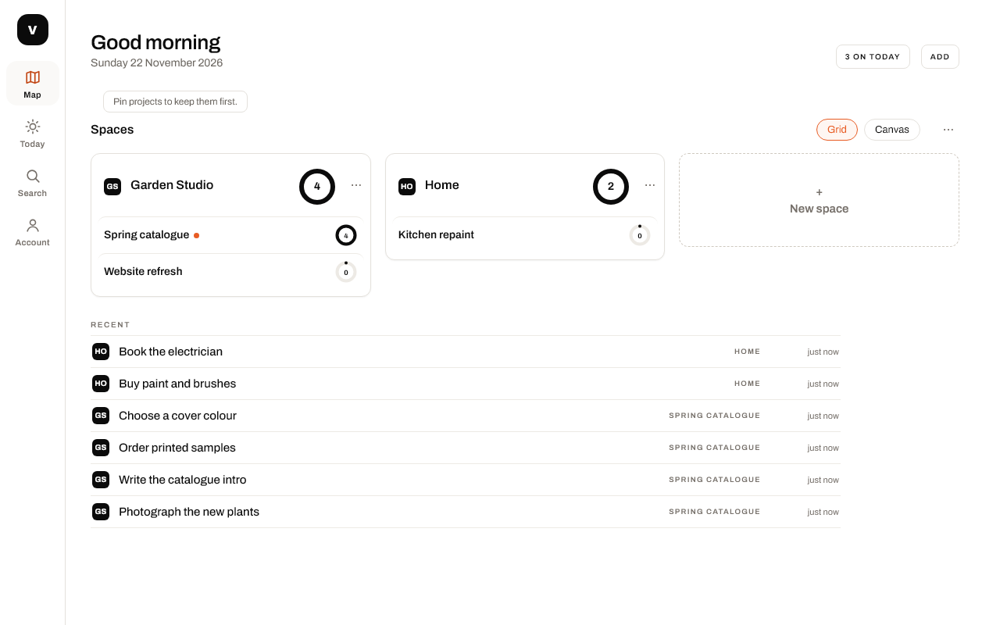
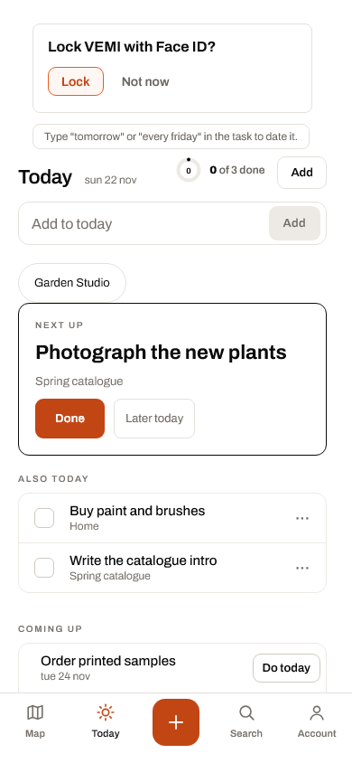
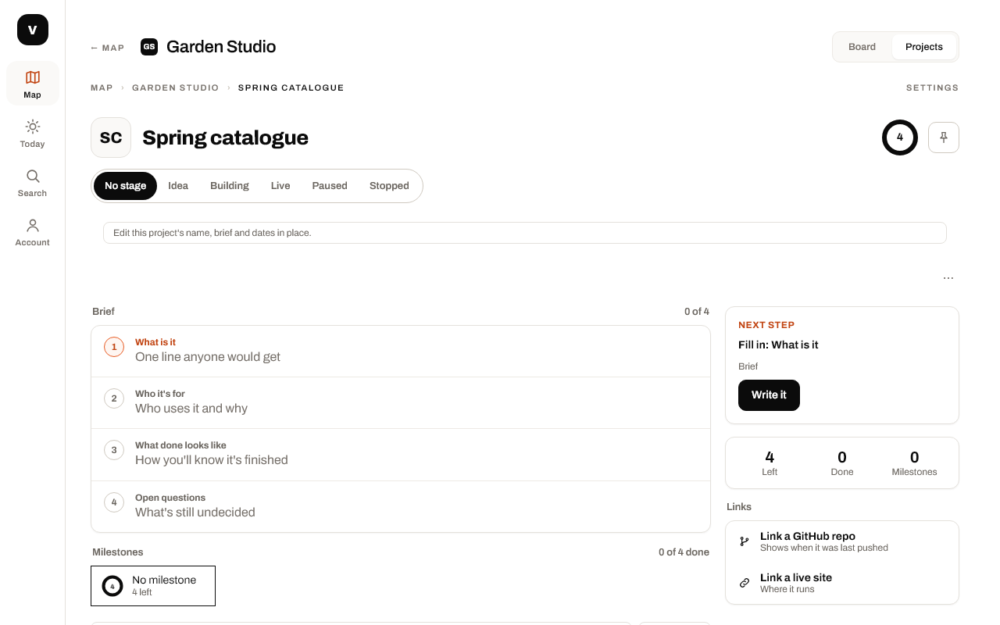

<h1 align="center">
  <picture>
    <source media="(prefers-color-scheme: dark)" srcset="brand/vemi-wordmark-white.svg">
    
  </picture>
</h1>

 Free on Cloudflare's free plan.

Everything you're building, in one place.

VEMI is a planner for one person running several things at once. You keep your spaces, projects,
milestones and tasks together, see them on one map and plan each day. It is free and open
source. You run your own copy, so your work sits in your own account and nobody else holds it.

## What it does

- Spaces, projects, milestones and tasks, for one person running several things at once.
- Today and a calm first run.
- Locked notes and optional full-account encryption.
- Reminders on your own devices.
- Your own Claude or ChatGPT can work in it.

## Three ways in

- Try it now: runs in your browser and keeps everything on that device. See [Try it](docs/try-it.md).
- Get my own VEMI: the setup helper makes a copy in your own free Cloudflare account. See [Self-hosting](docs/self-hosting.md).
- The Deploy button above makes a copy in your Cloudflare account too. See [Getting started](docs/getting-started.md).

Your own copy, with the button:

1. Deploy: press the button above and follow Cloudflare's steps. It makes a copy in your own
   Cloudflare account, with its own database, on the free plan.
2. Open the address Cloudflare gives your copy (it ends in `workers.dev`).
3. Make the first account. Whoever does this owns the copy.

## Is it free?

Yes. VEMI is free and open source. A copy runs on Cloudflare's free plan, which needs no card.
There is no paid VEMI service.

## Limits

- A copy shares Cloudflare's free allowance: 100,000 requests a day and 5 GB of database. That is
  far more than one person and a few invitees use. [Self-hosting](docs/self-hosting.md) has the
  full table.
- Reminders are push on your own devices. They are per device, and VEMI sends no email.
- Your database can be rewound for 7 days. Keep an export file for anything older, as in
  [Backups](docs/backups.md).
- Local mode keeps data in one browser. Clearing that browser's site data deletes it.
- Pull requests are not accepted yet.

If something goes wrong, see [Troubleshooting](docs/troubleshooting.md).

## Help

- [Help index](docs/index.md)
- [Getting started](docs/getting-started.md)
- [Reminders](docs/reminders.md)
- [Connect your AI](docs/connect-your-ai.md)
- [Keyboard](docs/keyboard.md)
- [Backups](docs/backups.md)
- [Privacy](docs/privacy.md)
- [Questions](docs/faq.md)
- [Troubleshooting](docs/troubleshooting.md)
- [Try it](docs/try-it.md)
- [Updating](docs/updating.md)
- [Self-hosting](docs/self-hosting.md)
- [Releasing](docs/releasing.md)

Made by Anvil Dynamics.

## Licence

- The code is MIT. See [LICENSE](LICENSE).
- The VEMI name and logo belong to Anvil Dynamics. You may not use them to suggest that a fork is
  the official VEMI.
- The bundled fonts are under the SIL Open Font License. The full text is shown in the app's
  About screen.

## Community

- [Code of conduct](CODE_OF_CONDUCT.md)
- [Contributing](CONTRIBUTING.md)
- [Security](SECURITY.md)

Issues welcome. Pull requests are not accepted yet.
