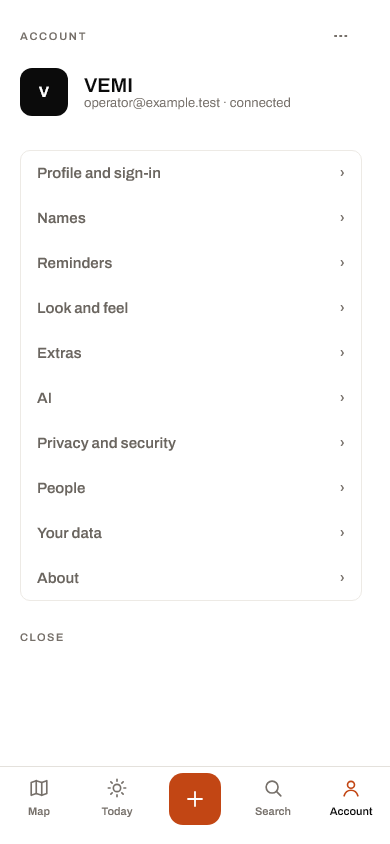

# Backups

Your data can be saved two ways: a file you keep, and a database rewind that whoever runs the copy can do.

## Export

In Account, under Your data, press JSON next to Export everything. You get one file with everything you have made, archived items included. If you have locked notes, VEMI asks whether to keep locked content locked in the file.

## Restore

1. In Account, under Your data, press Choose file and pick an export file.
2. VEMI shows a preview of what the file holds. Nothing has changed yet.
3. Type replace, then press Replace everything. Restore replaces what is in your account with the file.

### Locked notes

A file that holds locked notes needs its own way in before it can be restored: a passkey, the vault password or the recovery key the file was made with. Once you have shown it, each locked note is locked again for this account. A file that holds locked content but not the way to open it can't be restored there.

## Time Travel

Cloudflare keeps a rewind of the database for 7 days on the free plan. Whoever runs the copy can run it, from their own Cloudflare account, with `wrangler d1 time-travel restore <database> --timestamp=<unix time>`. It puts the whole database back to that moment, for everyone on the copy. Locked notes come back as they were, still locked.

## Deleting your account

If you were invited to a copy, Account, under Your data, has Delete my account. Press Delete, type delete, then press Delete my account. It goes after 7 days, and you can cancel until then.
