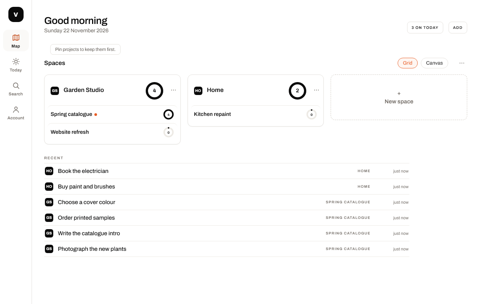
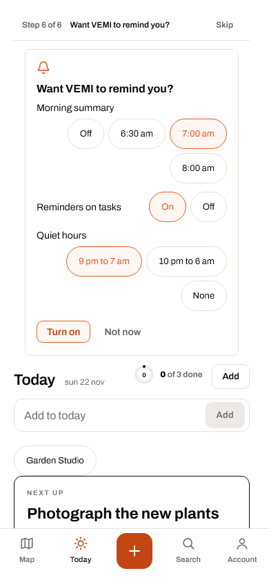
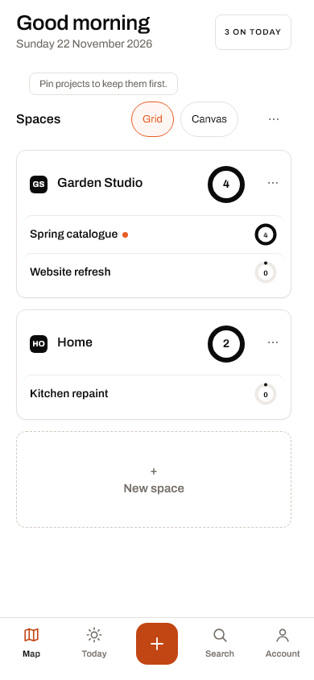
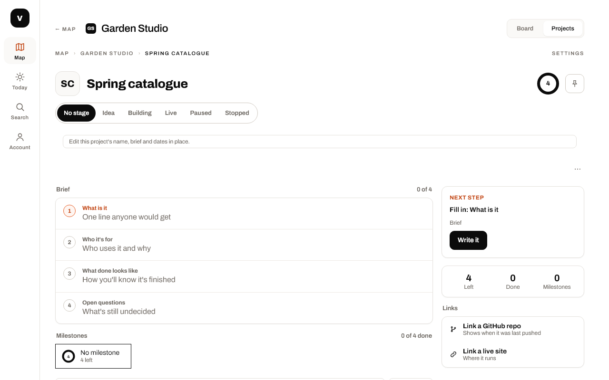
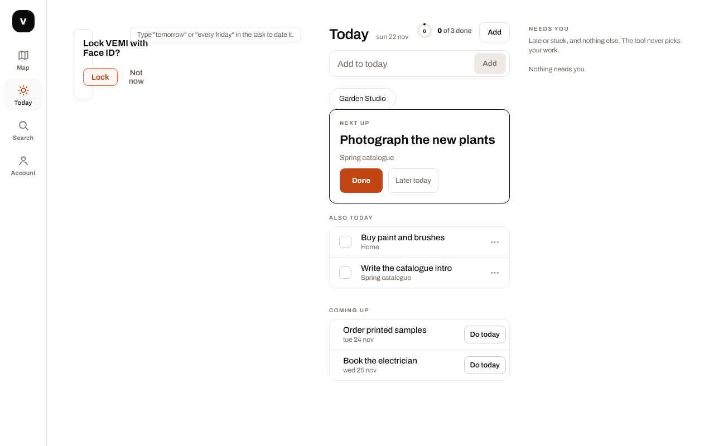
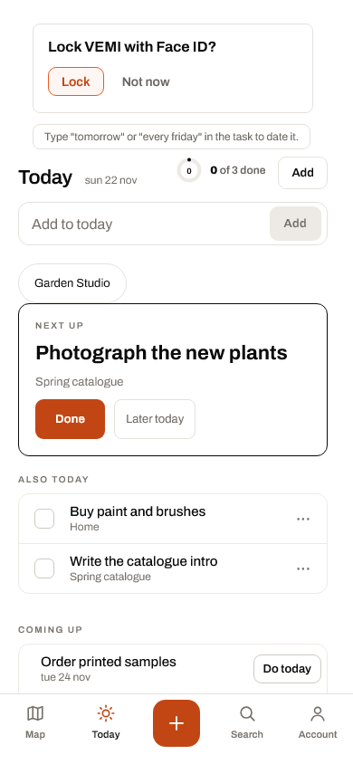

# Getting started

## Three ways in

1. **Try it now.** Open the Try it now link on the VEMI page. It runs in your browser and keeps everything on that device. Nothing is sent anywhere.
2. **Get my own VEMI.** The setup helper makes a copy of VEMI in your own free Cloudflare account and hands you over to it.
3. **The Deploy button.** On the project's page, the Deploy to Cloudflare button makes a copy in your Cloudflare account too. The first person to make an account on a copy owns it. After that it is invite only.

Whoever runs a copy can invite other people. Each account is one person, and nobody sees anyone else's data.

## First run

The first time you open your own VEMI, a slim bar along the top counts you through a few steps. You can press Skip at any time.

1. Say what you are using VEMI for, which sets the names of the levels.
2. Name your first space.
3. Add a project to it.
4. Add a task to it.
5. Put it on today.
6. Choose whether VEMI reminds you. Nothing is on until you say so.
7. On a phone that can, add VEMI to your home screen.

## The four levels

Everything sits in four levels:

- **Spaces** hold the things you are running.
- **Projects** are the pieces of work inside a space.
- **Milestones** mark the steps of a project.
- **Tasks** are the things to do.

The map shows your spaces and what is in them.

A project page holds its brief, its milestones and its tasks.

You can rename all four levels in Account, under Names. First run's first step offers a few sets of names to start from.

## Today

Today is your plan for the day. It shows how many of today's tasks are done, the next one to do, the rest of today, and what is coming up tomorrow and this week. Press Do today on a coming-up task to bring it in.

## Add with smart dates

The Add box understands plain words. Type them in the title and VEMI sets the date, the repeat or the reminder, then shows them as chips and takes the words out of the title. Tap a chip to put the words back.

| Type | What it sets |
| --- | --- |
| tomorrow | the date |
| next week | the date |
| a weekday name, such as friday | the next one |
| every day | a repeat |
| every weekday | a repeat |
| every friday | a repeat |
| every week | a repeat |
| every month | a repeat |
| at 3pm | the time, and a reminder |

You can switch smart dates off in Account, under Extras.
