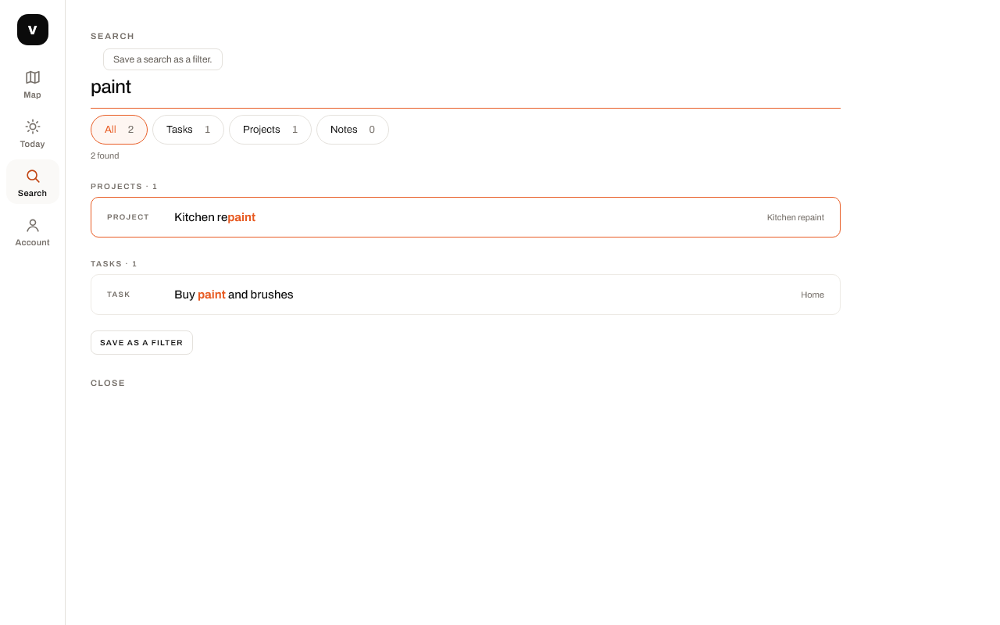

# Keyboard

Press `?` to see this list inside VEMI. On a Mac, use Cmd where this page says Ctrl.

| Keys | What it does |
| --- | --- |
| `Ctrl K` | Open or close the palette |
| `/` | Search |
| `N` | New task |
| `P` | New project |
| `G then M` | Map |
| `G then T` | Today |
| `G then S` | Search |
| `G then A` | Archive |
| `1  2` | Board and projects, inside a space |
| `?` | This list |
| `Esc` | Close the top layer |

Shortcuts never fire while you are typing.

## Switching the single keys off

The single keys are the ones that need one press: `/`, `N`, `P`, `G` then a letter, `1`, `2` and `?`. You can switch them off in Account, under Extras, with Single-key shortcuts. With them off, two shortcuts are left: `Ctrl K` and `Esc`. The palette always works.
